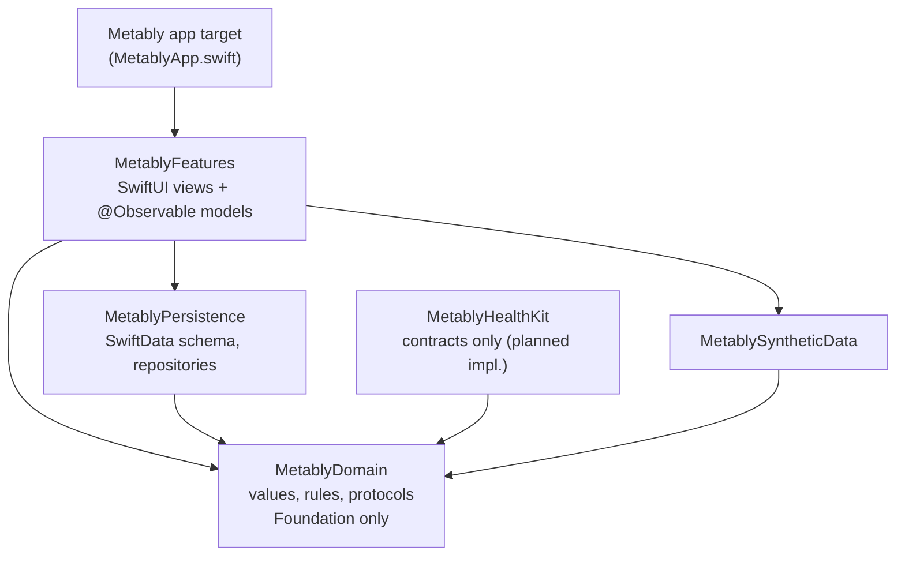
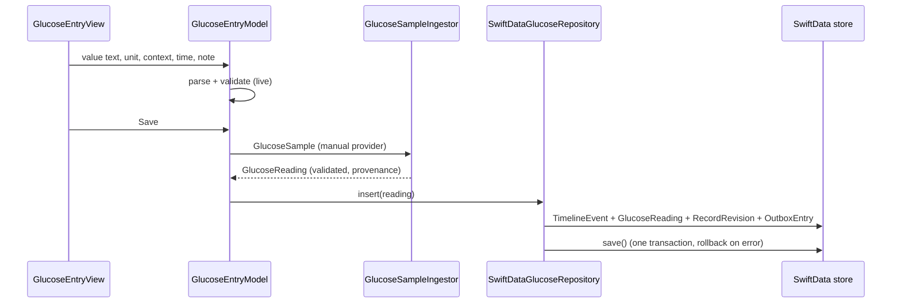

# Architecture overview

Status: implemented for milestone 0.1 unless marked *planned*.

## Principles

- **Local-first.** Every record is saved on the device before any network work. The app is fully
  usable offline and without an account.
- **Facts vs derived values.** Stored records hold what was measured or entered. Statistics are
  computed by an analytics layer (*planned*) and never stored as facts.
- **Lossless units and time.** Each reading keeps the value and unit as entered plus a canonical
  mmol/L value, and the UTC instant plus the IANA time zone it was taken in.
- **Provenance everywhere.** Each record says which source and provider created it.
- **Sync-ready from day one.** Records carry versions and device ids, every change writes a
  revision and an outbox entry in the same transaction. The sync engine itself is *planned*.

## Modules

| Module | Responsibility | Depends on |
|---|---|---|
| MetablyDomain | Value types, validation, unit conversion, diary day, provider and repository protocols, sync contracts | Foundation |
| MetablyPersistence | SwiftData models (schema V1), migration plan, `SwiftDataGlucoseRepository` | Domain, SwiftData |
| MetablyHealthKit | Protocols for authorization, anchored import, writing | Domain |
| MetablySyntheticData | Seeded generator of invented diaries | Domain |
| MetablyFeatures | Screens, view models, composition root (`AppDependencies`), localization | all of the above |

## Glucose entry flow

Every future source (HealthKit, Bluetooth meter, CGM, CSV) produces `GlucoseSample`s through a
`GlucoseDataProvider` and goes through the same ingestor, so validation and provenance rules are
identical for all sources.

## Concurrency

- Domain types are `Sendable` value types.
- Repositories and feature models are `@MainActor`, because SwiftData's `mainContext` is bound to
  the main actor. Heavy imports (HealthKit, CSV) will use a background `ModelActor` (*planned*).

## Storage

- SwiftData with a `VersionedSchema` (V1) and `SchemaMigrationPlan` from the start.
- `cloudKitDatabase: .none`: health data never goes to iCloud. See ADR 0004.
- Enum values are stored as raw strings so predicates and migrations stay simple.
- Default iOS data protection applies to the store file. Choosing between `complete` and
  `completeUntilFirstUserAuthentication` is open until background HealthKit delivery exists.

## Privacy rules in code

- No measurement values, notes or ids in logs (`OSLog` messages log error types only).
- Synthetic data only in previews, tests and the Debug data loader; it is marked `source = synthetic`.
- Target status uses the user's own targets, which default to the ADA values (ADR 0006). Status is
  never shown by colour alone.
